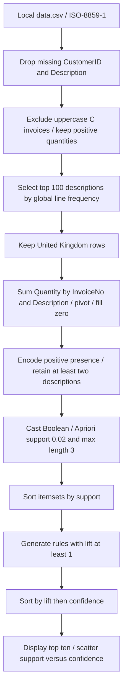
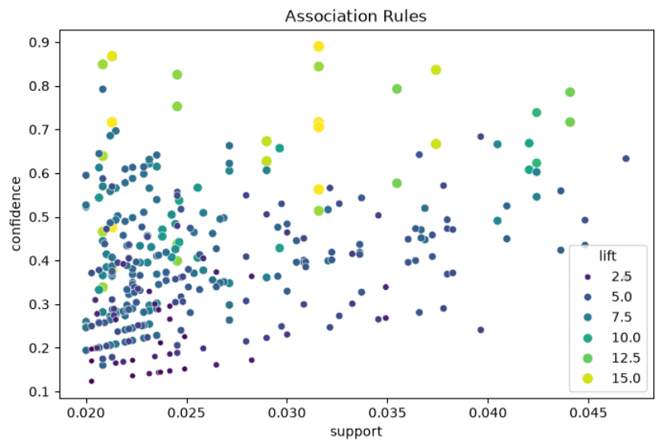

<p align="center">
  
</p>

# Market Basket Intelligence

**Discovering Product Relationships Through Association Rule Mining**

An evidence-led retail analytics case study using pandas, Apriori, and mlxtend.
Explore the [original notebook](ecommerce_market_basket.ipynb), the
[implementation](ecommerce_market_basket.py), and the
[preservation baseline](docs/EVIDENCE_BASELINE.md).

> **Evidence boundary:** saved notebook previews demonstrate historical analytical
> output. The input CSV, complete result tables, and environment lock are absent.
> The standalone script has a syntax error; see reproduction caveats below.
> No mining was rerun for this documentation review.

[Problem](#02-business-problem) · [Dataset](#03-dataset-intelligence) ·
[Engineering](#06-transaction-basket-engineering) · [Metrics](#10-understanding-the-metrics) ·
[Results](#12-verified-results) · [Reliability](#15-reliability-and-limitations) ·
[Reproduce](#17-installation-and-reproduction)

## 01 Executive overview

This project converts invoice line items into product-presence baskets and mines
frequent itemsets of up to three descriptions. Association rules are retained at
lift >= 1 and ranked by lift, then confidence. The saved output includes strong
co-occurrence between pink and green Regency teacup descriptions.

The implemented population is precise: **UK invoices with known CustomerID and
Description, positive quantities, no uppercase-C invoice prefix, and at least two
distinct descriptions from a globally selected top-100 list**. Metrics are
conditional on this population. The work demonstrates exploratory association
mining; commercial impact has not been measured.

## 02 Business problem

Invoice rows describe individual products; retail decisions often depend on
which products occur together. The analytical question is: within the selected
invoice population, how much more often does B appear when A is present than
its baseline frequency would suggest?

Potential applications include cross-sell candidates, bundle experiments, and
merchandising review. The repository contains no recommendation service,
personalization system, inventory forecast, or measured revenue uplift.

## 03 Dataset intelligence

The original README attributes the input to
[Kaggle E-Commerce Data](https://www.kaggle.com/datasets/carrie1/ecommerce-data).
The actual loader reads a local `data.csv` with `encoding='ISO-8859-1'`; no
acquisition code, file checksum, or dataset version is recorded.

The related [UCI Online Retail source](https://archive.ics.uci.edu/dataset/352/online+retail)
reports 541,909 line-item records spanning 1 December 2010 to 9 December 2011.
Its schema lists eight variables. These are **source-level facts**, not a
verified shape or date range for the missing local CSV. The preview's column
names match that source's schema; this alone cannot establish file identity.

| Evidence | What can be established |
| --- | --- |
| Saved cell 4 preview | Five rows, eight named columns; invoice 536365 appears repeatedly |
| Expected input columns | InvoiceNo, StockCode, Description, Quantity, InvoiceDate, UnitPrice, CustomerID, Country |
| Row versus transaction | One row is a product line; the mined transaction is an InvoiceNo group |
| Missing values | CustomerID and Description are explicitly dropped when missing; missing counts are not saved |
| Local size and dates | Full shape, unique invoices, and date extrema are unavailable |

No claim of locally verified production provenance is made. The source's missing
value metadata cannot replace inspection of the actual CSV.

See the [provenance and acquisition record](docs/DATA_PROVENANCE.md) for the
evidence chain and the checks needed to identify a future input snapshot.

The [feature dictionary](docs/DATA_DICTIONARY.md) explains every input column,
its actual role, and the grain of the derived analytical objects.

## 04 Understanding market basket analysis

An **itemset** is an unordered set of descriptions. A frequent itemset meets a
minimum fraction of baskets. A **rule** A -> B separates a frequent itemset into
nonempty, disjoint antecedent and consequent sets. All antecedent items must be
present; the consequent may also contain multiple items.

These are within-invoice associations, without purchase ordering or causal
interpretation. Reversing a rule generally changes its confidence.

## 05 Data cleaning

The notebook (cell 6) and script (lines 16-19) implement these operations in order:

```python
df = df.dropna(subset=['CustomerID', 'Description'])
df['InvoiceNo'] = df['InvoiceNo'].astype(str)
df = df[~df['InvoiceNo'].str.startswith('C')]
df = df[df['Quantity'] > 0]
```

CustomerID is required by this filter, although it is not used as a basket key.
Cancellation exclusion is case-sensitive and does not reconcile subsequent
returns against original purchases. **No UnitPrice validation, duplicate removal,
description normalization, or StockCode consistency check is implemented.**
Removal counts and the effect of excluded anonymous purchases are unknown.

The [cleaning methodology](docs/CLEANING_METHODOLOGY.md) distinguishes filter
guarantees, partial-invoice effects, and checks that are still unimplemented.

## 06 Transaction basket engineering

After top-description selection, the implementation aggregates quantities by
UK invoice and description, fills absent combinations with zero, and encodes
positive totals as presence:

```python
basket = (df_filtered[df_filtered['Country'] == 'United Kingdom']
          .groupby(['InvoiceNo', 'Description'])['Quantity']
          .sum().unstack().fillna(0))
basket_sets = basket.map(lambda x: 1 if x > 0 else 0)
basket_sets = basket_sets[(basket_sets.sum(axis=1) >= 2)]
```

Rows represent invoices, columns represent exact description strings, and each
cell becomes 0 or 1. Apriori receives `basket_sets.astype(bool)`. Ten units and
one unit therefore have equal presence weight. Repeat purchases by a customer
on different invoices remain separate baskets.

The >= 2 test counts **selected descriptions**, not units or all items on the
original invoice. Removing singleton baskets changes the support denominator
and can also change confidence and lift.

See [basket engineering](docs/BASKET_ENGINEERING.md) for a formal population
definition and a worked example of the denominator change.

## 07 Product filtering strategy

```python
top_products = df['Description'].value_counts().head(100).index
df_filtered = df[df['Description'].isin(top_products)]
```

Selection occurs **after cleaning and before country filtering**. It ranks
cleaned row frequency across all countries, rather than quantity, revenue, or
unique UK invoice frequency. Duplicate lines can affect that ranking.

Invoices without selected descriptions disappear; invoices retaining only one
selected description are subsequently excluded. Patterns involving descriptions
outside this universe cannot be discovered. Actual UK matrix width is not saved
and must not be assumed to equal 100.

The [product and country scope analysis](docs/PRODUCT_SCOPE.md) separates
catalog restriction from the resulting changes to invoice eligibility.

## 08 Apriori algorithm

The exact notebook call (cell 10) is:

```python
frequent_itemsets = apriori(
    basket_sets.astype(bool), min_support=0.02, use_colnames=True,
    low_memory=True, max_len=3
)
frequent_itemsets = frequent_itemsets.sort_values(by='support', ascending=False)
```

| Parameter | Implemented value | Meaning |
| --- | --- | --- |
| `min_support` | `0.02` | Itemsets must occur in at least 2% of retained baskets |
| `max_len` | `3` | Search includes singleton, pair, and triple itemsets |
| `low_memory` | `True` | Iterator-based candidate processing trades speed for memory |
| `use_colnames` | `True` | Itemsets contain description labels |
| Input dtype | Boolean | Presence/absence rather than purchase quantity |

Apriori uses the property that every subset of a frequent itemset is frequent
to prune candidates. The threshold is a frequency cutoff, with **no statistical
significance guarantee**. Four-item combinations are outside the search.
See the [mlxtend Apriori documentation](https://rasbt.github.io/mlxtend/user_guide/frequent_patterns/apriori/).

The [configuration reference](docs/APRIORI_CONFIGURATION.md) records search
boundaries, minimum-count interpretation, and unchecked empty-input cases.

## 09 Association rule generation

```python
rules = association_rules(frequent_itemsets, metric="lift", min_threshold=1.0)
rules = rules.sort_values(by=['lift', 'confidence'], ascending=[False, False])
```

Lift equal to 1 is eligible. No additional confidence cutoff or support sorting
is applied. Itemset support already limits candidate rules. The complete itemset
table is passed to rule generation; `.head(10)` only limits the displayed preview.

The notebook uses the standard mlxtend rule API; dependency versions are not
recorded. See the [official rule guide](https://rasbt.github.io/mlxtend/user_guide/frequent_patterns/association_rules/).
A rule is an observed relationship in selected invoices, not evidence that
recommending B to purchasers of A will cause an additional sale.

See the [rule-generation reference](docs/ASSOCIATION_RULES.md) for ranking,
multi-item semantics, and the limits of the truncated output.

## 10 Understanding the metrics

Let N be retained baskets and n(X) count baskets containing every item in X.

| Metric | Definition | Reading |
| --- | --- | --- |
| Itemset support | `s(X) = n(X) / N` | Fraction of retained baskets containing X |
| Rule support | `s(A -> B) = s(A union B)` | Joint occurrence, not antecedent frequency |
| Confidence | `s(A union B) / s(A)` | Observed conditional frequency of B given A |
| Lift | `s(A union B) / (s(A) * s(B))` | Joint occurrence relative to independence |

Lift > 1 indicates positive association, lift = 1 matches independence for these
item-presence events, and lift < 1 indicates negative association. Lift is
symmetric under reversal; confidence is directional. None measures profit.

**Illustration, not a project result:** among 100 baskets, suppose A occurs in
20, B in 10, and both in 5. Support is 5%, confidence A -> B is 25%, and lift is
2.5. Reverse confidence is 50%. These calculations use a fixed population.

The [metrics guide](docs/METRICS_GUIDE.md) adds interpretation pitfalls and an
arithmetic consistency check using the rounded saved teacup-rule metrics.

## 11 Mining architecture



The diagram describes notebook stages. The script's parse error prevents its
execution as supplied. There is no deployed serving or evaluation stage.

## 12 Verified results

These values are transcribed from saved outputs, rounded to six decimals.
They have **not** been independently recomputed from the missing input.

| Frequent singleton, cell 10 | Saved support |
| --- | ---: |
| WHITE HANGING HEART T-LIGHT HOLDER | 0.164505 |
| JUMBO BAG RED RETROSPOT | 0.130233 |
| REGENCY CAKESTAND 3 TIER | 0.119396 |

Two fully readable rules from cell 12:

| Antecedent | Consequent | Support | Confidence | Lift |
| --- | --- | ---: | ---: | ---: |
| PINK REGENCY TEACUP AND SAUCER | GREEN REGENCY TEACUP AND SAUCER | 0.037421 | 0.836439 | 14.901311 |
| GREEN REGENCY TEACUP AND SAUCER | PINK REGENCY TEACUP AND SAUCER | 0.037421 | 0.666667 | 14.901311 |

The first displayed rule has support 0.021304, confidence 0.716511, and lift
16.015428, but its antecedent is truncated in both text and HTML. Its full
membership cannot be reported. Total frequent itemsets, total rules, and retained
basket count are unavailable; DataFrame index labels are not counts.

The [saved-result ledger](docs/VERIFIED_RESULTS.md) transcribes all ten visible
itemsets and all ten rule metric rows, and records the two original plot artifacts.

## 13 Visual analysis



The preserved chart shows the rule metric distribution. Larger, brighter points
encode greater lift, not order value or profit. Support and confidence describe
the filtered population. Overlapping points and absent product labels prevent
identification of a particular rule or recovery of a reliable rule count.

The notebook also saves a similar scatter at a different image resolution.
Neither chart has an input checksum or run manifest linking it to a reproducible
CSV snapshot. The banner above is decorative, not a result visualization.

## 14 Business interpretation

The visible pink -> green teacup rule suggests a coordinated-product candidate
for merchandising review: roughly 83.64% of retained invoices containing pink
also contain green. This is conditional co-occurrence, without customer-level
prediction or proof of incremental demand.

| Possible use | Evidence needed before adoption |
| --- | --- |
| Cross-sell experiment | Temporal validation, inventory availability, randomized uplift measurement |
| Bundle design | Margin, price, substitution, and cannibalization checks |
| Merchandising review | Stable product identifiers and explanation of coordinated variants |
| Fulfilment exploration | Actual order volumes, layout constraints, and measured picking effects |

All are unimplemented proposals. High lift alone cannot establish business value.

## 15 Reliability and limitations

The [read-only technical audit](docs/CODE_AUDIT.md) records 14 findings with
source locations, evidence, severity, status, impact, and proposed corrections.

- **Population selection:** known-customer filtering, global top descriptions,
  UK selection, and singleton exclusion restrict generalization.
- **Data quality:** duplicate lines, price validity, description aliases, missing
  identifiers, and invoice consistency are not validated.
- **Transaction meaning:** invoice co-occurrence does not encode purchase order,
  customer independence, return reconciliation, or net revenue.
- **Sensitivity:** one support setting and a three-item cap are used; stability,
  uncertainty, multiple comparisons, and temporal holdout are unmeasured.
- **Provenance:** no local CSV, checksum, raw shape, cleaning log, full outputs,
  or package lock is included. Historical outputs are partial evidence.
- **Execution:** the script has broken print literals; the notebook code parses
  but its full execution has not been verified in this review.
- **Causality:** associations support hypotheses, with no demonstrated sales lift.

## 16 Repository structure

Exact tracked project tree after the documentation update:

```text
Ecommerce-Market-Basket/
|-- docs/
|   |-- APRIORI_CONFIGURATION.md
|   |-- ASSOCIATION_RULES.md
|   |-- BASKET_ENGINEERING.md
|   |-- CLEANING_METHODOLOGY.md
|   |-- CODE_AUDIT.md
|   |-- DATA_DICTIONARY.md
|   |-- DATA_PROVENANCE.md
|   |-- EVIDENCE_BASELINE.md
|   |-- METRICS_GUIDE.md
|   |-- PRODUCT_SCOPE.md
|   |-- REPRODUCTION.md
|   |-- VALIDATION.md
|   `-- VERIFIED_RESULTS.md
|-- images/
|   |-- association_rules_plot.png
|   `-- market-basket-intelligence-banner.svg
|-- CONTRIBUTING.md
|-- LICENSE
|-- README.md
|-- ecommerce_market_basket.ipynb
|-- ecommerce_market_basket.py
`-- requirements.txt
```

`data.csv` is expected at runtime but is absent from the tracked repository.

See [contribution guidance](CONTRIBUTING.md) for evidence standards and
[validation evidence](docs/VALIDATION.md) for preservation and documentation checks.

## 17 Installation and reproduction

The [reproduction and troubleshooting guide](docs/REPRODUCTION.md) covers
kernel selection, input checks, version caveats, and common failure modes.

Review existing outputs by opening the notebook without executing it. For an
independent future run, create a disposable clone:

```bash
git clone https://github.com/khaled-amireh/Ecommerce-Market-Basket.git
cd Ecommerce-Market-Basket
python -m venv .venv
```

Activate with `.venv\Scripts\Activate.ps1` in PowerShell or
`source .venv/bin/activate` on macOS/Linux, then:

```bash
python -m pip install -r requirements.txt
python -m pip install notebook ipykernel
python -m ipykernel install --user --name market-basket --display-name "Market Basket"
python -m notebook ecommerce_market_basket.ipynb
```

Jupyter tooling is an additional local installation, absent from the manifest.
Obtain the CSV from the attributed Kaggle page, review its terms, and place it
as `data.csv` in the repository root. Confirm all eight required columns and
record its checksum before running. A UCI Excel download cannot be renamed to
CSV; conversion and equivalence verification would be separate work.

Select the Market Basket kernel and run cells in order only in that disposable
copy. Execution can overwrite saved notebook outputs. Python 3.11.9 is recorded
in notebook metadata; package versions and a tested compatibility range are
unknown. `DataFrame.map` requires pandas 2.1+ according to the
[pandas API reference](https://pandas.pydata.org/docs/reference/api/pandas.DataFrame.map.html).
Fresh unpinned installs are not guaranteed to reproduce the historical run.

**Do not expect `python ecommerce_market_basket.py` to work as supplied:** its
print literals at lines 34-35 and 41-42 are syntactically invalid. It also writes
`association_rules_plot.png` to the current directory, whereas the tracked chart
is in `images/`. The implementation was preserved during documentation work.

## 18 Roadmap, author and credits

Future work: establish an input checksum and environment lock; repair the script
in a separately authorized code change; log stage counts; validate prices,
duplicates and product identities; compare UK-specific product selection and
all-invoice denominators; export complete results; assess temporal stability;
then evaluate any commercial intervention with a controlled experiment.
None of these improvements is implemented here.

**Khaled Amireh** | [GitHub](https://github.com/khaled-amireh) |
[Portfolio](https://portfolio-1kpn.onrender.com)

Repository code is covered by the [MIT license](LICENSE). Dataset rights and
attribution must be checked separately at its source. Credit to the pandas,
NumPy, mlxtend, Matplotlib, seaborn, and Jupyter communities.
