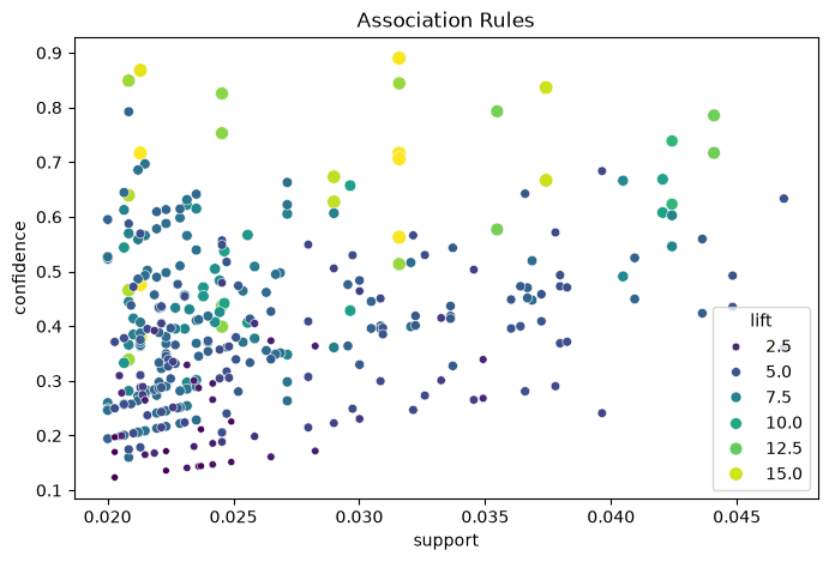

# Saved-result evidence ledger

Inspected on 2026-11-08. Source: the unchanged
[notebook](../ecommerce_market_basket.ipynb), saved outputs only. No input data
was available and no mining was executed. Values below are display precision,
not exact underlying floating-point values. “Verified” means transcribed and
cross-checked against saved text and HTML, not independently reproduced.

## Frequent-itemset preview

Cell 10 (`c7a26fb4`, execution count 75) displays ten support-sorted singleton
itemsets. Literal spaces in labels are preserved inside code spans.

| Saved row label | Singleton description | Support |
| --- | --- | ---: |
| 94 | `WHITE HANGING HEART T-LIGHT HOLDER` | 0.164505 |
| 37 | `JUMBO BAG RED RETROSPOT` | 0.130233 |
| 76 | `REGENCY CAKESTAND 3 TIER` | 0.119396 |
| 6 | `ASSORTED COLOUR BIRD ORNAMENT` | 0.112171 |
| 64 | `PARTY BUNTING` | 0.110504 |
| 50 | `LUNCH BAG RED RETROSPOT` | 0.103001 |
| 44 | `LUNCH BAG  BLACK SKULL.` | 0.091052 |
| 83 | `SET OF 3 CAKE TINS PANTRY DESIGN ` | 0.089848 |
| 62 | `PAPER CHAIN KIT 50'S CHRISTMAS ` | 0.082438 |
| 25 | `HEART OF WICKER SMALL` | 0.082345 |

These are the displayed top ten itemsets, not ten total itemsets and not the
top product-pair ranking. Their original row labels are retained for tracing.

## Rule preview metrics

Cell 12 (`e9595a4d`, execution count 76) displays the following ten rows after
sorting by lift then confidence. Full membership is unavailable for eight rows
because a side is clipped in **both** saved text and HTML.

| Saved row label | Support | Confidence | Lift | Membership evidence |
| --- | ---: | ---: | ---: | --- |
| 275 | 0.021304 | 0.716511 | 16.015428 | Antecedent truncated; consequent pink teacup |
| 278 | 0.021304 | 0.476190 | 16.015428 | Antecedent pink teacup; consequent truncated |
| 65 | 0.031586 | 0.716387 | 16.012649 | Antecedent truncated; consequent pink teacup |
| 68 | 0.031586 | 0.706004 | 16.012649 | Antecedent pink teacup; consequent truncated |
| 67 | 0.031586 | 0.562706 | 15.861558 | Antecedent green teacup; consequent truncated |
| 66 | 0.031586 | 0.890339 | 15.861558 | Antecedent truncated; consequent green teacup |
| 276 | 0.021304 | 0.867925 | 15.462233 | Antecedent truncated; consequent green teacup |
| 277 | 0.021304 | 0.379538 | 15.462233 | Antecedent green teacup; consequent truncated |
| 29 | 0.037421 | 0.836439 | 14.901311 | Fully visible: pink → green |
| 28 | 0.037421 | 0.666667 | 14.901311 | Fully visible: green → pink |

“Pink teacup” means the exact label `PINK REGENCY TEACUP AND SAUCER`;
“green teacup” means `GREEN REGENCY TEACUP AND SAUCER`. Abbreviations here are
editorial shorthand, not a catalog normalization step. No other clipped label
has been expanded. The first displayed metrics must not be attributed to the
fully visible pair at rows 29 and 28.

## Authentic visual evidence

The standalone tracked PNG is 829 × 561 pixels. The notebook's embedded PNG in
cell 14 is 691 × 469 pixels (74145 bytes; SHA-256
`61e561f49369df9604ebd27be818d150db3a6ccc443e6b669ed7a2d6c3c3786a`).
Both were visually inspected; they show similar distributions but are distinct
artifacts, not byte-identical exports. No file was overwritten.

The axes are support and confidence; hue and size encode lift. Multiple rules
can overlap at identical coordinates. The scatter cannot validate product
membership, total rule count, statistical significance, or commercial benefit.
Neither image has a saved CSV checksum or run manifest.

## Unavailable evidence

The repository does not save raw shape, date extrema, filter counts, selected
product list, basket dimensions, total frequent itemsets, total rules, exact
occurrence counts, full multi-item membership, timing, memory, holdout scores,
or business impact. Rounded metrics cannot safely recover these. Execution
counts 71–77 and Python 3.11.9 metadata document a historical notebook session,
without proving a fresh top-to-bottom execution or input identity.
